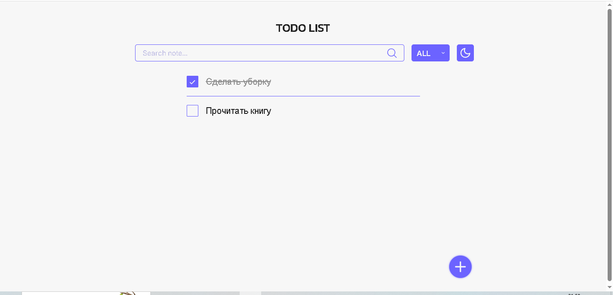
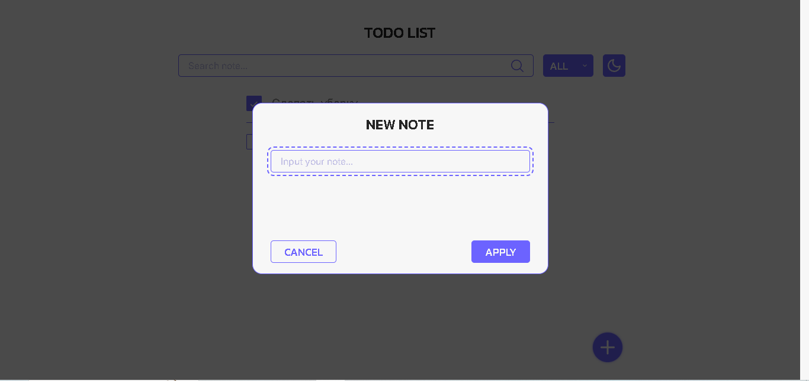
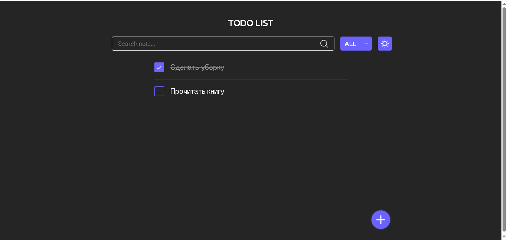

# Todo List

Todo-приложение на чистом JavaScript

## Демо

🔗 [Открыть приложение](https://daryatash.github.io/todo-list-js/)

- Главная страница

- Добавление новой заметки

- Темная тема

## Возможности

- ✏️ Создание заметок через модальное окно.
- ✅ Отметка выполненных заметок.
- 🗑️ Удаление заметок.
- 🔍 Поиск по тексту заметок.
- 🎛️ Фильтр: все / выполненные / невыполненные.
- 💾 Сохранение в `localStorage`.
- 🌙 Тёмная тема — кнопка-переключатель + автоматическое определение 
  через `prefers-color-scheme`.
- 📱 Адаптивность — от мобильных до десктопа.

## Стек

- HTML
- SCSS → CSS
- JavaScript (классовый подход)

## Макет

🔗 [Ссылка на макет](https://www.figma.com/community/file/1287029163993360080/simple-todo-list-design)